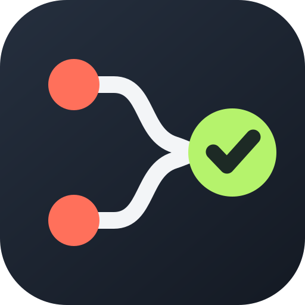

# GitHub PR Notifications extension

Browser notifications for GitHub pull request CI status changes, comments, and reviews — plus
automatic syncing of your PRs into a bookmark folder.

<a href="https://chrome.google.com/webstore/detail/github-pr-notifications/ekcbhjllakigielkhnkingmfpbgfgiie">
<br />Click to Install
</a>

## Features

- **CI notifications** — get a desktop notification when checks on an open PR tab finish
  (✅ all passed) or when an individual check fails (❌).
- **Comment & review notifications** — new comments (💬), inline review comments, and reviews
  (🔍 approved / changes requested) on the PR you have open.
- **Click to focus** — clicking a notification focuses the window and tab of the PR it came from.
- **PR bookmark sync** — periodically fetches your pull requests from the GitHub API and mirrors
  them into a bookmark folder of your choice. Bookmark titles are prefixed with a colored circle
  showing status:

  | Emoji | Meaning                        |
  | ----- | ------------------------------ |
  | 🟢    | open, checks passing (or none) |
  | 🟡    | open, checks pending           |
  | 🔴    | open, checks failing           |
  | ⚪    | draft                          |
  | 🟣    | merged                         |
  | ⚫    | closed without merging         |

- **Popup or sidebar** — view your synced PRs in a compact toolbar popup or a persistent native
  sidebar in Chrome and Firefox, with a badge counting failing PRs and an optional limit based
  on how recently each PR was updated.
- **Configurable** — which events notify, which PRs to sync (opened by you / assigned /
  mentioned / review-requested; open, closed, or all), how many (default 10, single request,
  no pagination), repositories to exclude, how often, notification icon style, and GitHub
  Enterprise hosts.

## Setup

1. Install the extension and open **Options** (right-click the toolbar icon → Options).
2. For bookmark sync, add a
   [personal access token](https://github.com/settings/tokens) — classic with `repo` scope, or
   fine-grained with read access to pull requests. The token is stored locally in your browser
   and only ever sent to your GitHub host.
3. Enable **PR bookmark sync**, pick (or create) a bookmark folder, and save.

Choose **Options → Display → Display mode → Popup / Sidebar**, then **Save** to choose what
the next toolbar-icon click opens. Popup is the default, and the choice is stored locally for
all windows of that browser. Saving leaves existing views open. The sidebar stays open when
you open a PR and updates as background sync finishes. Its side is controlled by browser settings.
If the browser does not support native sidebars, the extension continues using the popup and
the Sidebar choice is disabled.

To hide inactive PRs from the popup and sidebar, set **Options → Display → Hide PRs not updated
within the past (days)**, for example `7`, then save. A day is a rolling 24 hours since the PR's
last update. The list updates immediately and automatically hides PRs as they age out. Enter `0`
or leave the field blank to show all PRs again (the default). This changes only the displayed
list: bookmarks, badge counts, notifications, and the unfiltered cache are unaffected. The list
filters the PRs already fetched, so it can contain fewer than the configured maximum without
fetching replacements. Cached PRs without a valid update timestamp stay hidden while filtering
is enabled, until the next successful sync supplies timestamps.

On each sync, PR bookmarks in the folder are removed and re-created from the API response;
anything else you keep in the folder (other bookmarks, subfolders) is left untouched.

To hide PRs from certain repositories, enter their `owner/repo` names in **Options → PR
bookmark sync → Excluded repositories**, one per line or separated by commas. Save, then
click **Sync now** (or wait for the next sync) to update the popup, bookmarks, and badge.
Exclusions apply before the maximum PR count. Clear the field to include all repositories again.

To limit the badge to recent activity, set **Options → Toolbar badge → Count PRs updated within
the past (hours)**, for example `24`, then save. Only open PRs with failing checks whose last
update is less than that many hours ago count toward the badge. The count updates immediately
from cached PRs and automatically decreases as PRs age out, even between syncs. Enter `0` or
leave the field blank to count all failing PRs (the default). This setting affects only the badge;
the popup, bookmarks, and notifications keep their existing behavior. Previously cached PRs
without timestamps become eligible for the time filter after the next successful sync.

CI/comment notifications need no token — they work by watching PR pages you have open in a tab.
Notifications are per-tab, so a PR must be open in some tab for you to get them; bookmark sync
is what covers everything else.

## Development

```bash
pnpm install
pnpm test          # vitest unit tests
pnpm run lint      # eslint + prettier
pnpm run build     # bundles to dist/chrome and dist/firefox
pnpm run build:zip # also produces store-ready zips
```

Load `dist/chrome` as an unpacked extension via `chrome://extensions` (Developer mode →
"Load unpacked"). For Firefox, load `dist/firefox/manifest.json` via
`about:debugging#/runtime/this-firefox` (note: Firefox MV3 host permissions must be granted
in the extension's Permissions settings).

Source layout:

- `src/background.js` — service worker: notifications, badge, sync alarm
- `src/content/inject.js` — PR page watcher (MutationObserver + Turbo navigation handling)
- `src/lib/` — testable modules: GitHub GraphQL client, bookmark sync, DOM parsing, settings
- `src/options`, `src/popup` — UI pages
- `tests/` — vitest suites for the lib modules

Releases: bump `version` in `package.json` (the build stamps it into the manifest), tag
`v<version>`, and push the tag — the release workflow builds zips, attaches them to a GitHub
Release, and publishes to the Chrome Web Store when store credentials are configured as
repository secrets (`CWS_CLIENT_ID`, `CWS_CLIENT_SECRET`, `CWS_REFRESH_TOKEN`).

## Notes & limitations

- CI/comment notifications rely on parsing GitHub's DOM, which changes over time. The parser
  targets stable anchors (comment permalinks, merge-box phrases) and falls back gracefully, but
  a GitHub redesign can still break it — the API-backed bookmark sync is unaffected by that.
- This is not an official GitHub project but is made with ❤️ for GitHub.

All Octocat images borrowed from the [Octodex](https://octodex.github.com/) or generated with
[myOctocat](https://myoctocat.com/build-your-octocat/).

#### Legal

GitHub, the GitHub logo design, Octocat and the Octocat logo design are exclusive trademarks
registered in the United States by GitHub, Inc.

Released under [MIT license](LICENSE)
